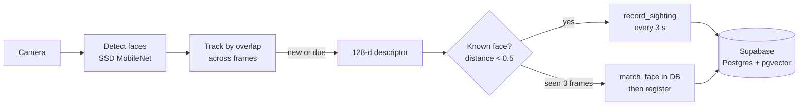

<div align="center">

# 👀 Seen Again

**Know who came back, when, and how often — from any camera, right in the browser.**

[English](README.md) · [ภาษาไทย](README.th.md)


</div>

---

Seen Again watches a camera, recognises faces, and keeps a visit log for every person it meets:
the first time they appeared, every time they came back, how long they stayed, and how long it had
been since their last visit.

Face detection and recognition run **entirely in the browser** (WebGL). No video ever leaves the
device — only a 128-number face descriptor, a small thumbnail and timestamps are stored.

## ✨ Features

- **Fast recognition** — ~15 fps on the GPU; a new face is boxed in ~0.2 s and registered in ~0.5 s
- **Visit counting** — a person who has been away longer than a set gap (default 5 min) starts a new visit
- **Per-person insights** — visit count, first/last seen, average gap, time on camera, busiest hours and weekdays
- **Visit history** — every visit numbered, with its thumbnail and the camera that saw it
- **Multiple cameras** — any number of devices share one face database; duplicates across cameras are avoided
- **Tidy-up tools** — rename people, merge duplicates, delete a person or everything
- **Private by default** — per-user Row Level Security, private image storage with short-lived signed URLs
- **Camera permission page** — clear guidance for every browser and OS when access is blocked

## 🧠 How it works



1. Every frame the browser finds faces and follows each one across frames, so the expensive
   descriptor is only computed for new faces (and refreshed once a second for known ones).
2. A descriptor is compared against known people by euclidean distance (threshold 0.5).
3. An unknown face seen on 3 frames is checked against the database once more (another camera may
   have just registered it) and only then saved as a new person.
4. While someone stays in view, `record_sighting` runs every 3 s **inside the database, on server
   time**. If they had been gone longer than the gap, it opens a new visit.

## 🚀 Getting started

Choose one setup.

| | Where it runs | Cost | Best for |
|---|---|---|---|
| **A. Home server** | Your own PC + [Tailscale](https://tailscale.com) | Free | Keeping all data at home, using it from anywhere |
| **B. Cloud** | [Supabase](https://supabase.com) + [Netlify](https://netlify.com) | Free tiers | No machine to keep running |

**Requirements:** Node.js 22+. Option A also needs [Docker Desktop](https://www.docker.com/products/docker-desktop/) (on Windows, with WSL 2).

### A. Home server (PC) + use from anywhere

Everything — app, database and images — lives on one PC. Tailscale links the PC with your laptop
over any network and provides the HTTPS certificate the camera requires. Only devices signed in to
your Tailscale account can reach it.

```
Laptop (camera + browser) ──HTTPS via Tailscale──▶ PC: app :3000 ──▶ Supabase (local) :54321
```

The browser talks to Supabase through the app at `/supabase`, so only one port is exposed.

**One-time setup on the PC**

```bash
git clone https://github.com/madara1150/seen-again.git
cd seen-again
npm install
npx supabase start        # first run downloads images; creates tables from supabase/migrations
```

Create `.env.local` with the **Publishable key** printed by `supabase start`:

```env
NEXT_PUBLIC_SUPABASE_URL=/supabase
SUPABASE_INTERNAL_URL=http://127.0.0.1:54321
NEXT_PUBLIC_SUPABASE_PUBLISHABLE_KEY=sb_publishable_...
```

Then:

1. Install Tailscale on **both** the PC and the laptop and sign in with the same account.
2. In the [Tailscale admin → DNS](https://login.tailscale.com/admin/dns), enable **MagicDNS** and **HTTPS Certificates**.
3. On the PC run `tailscale serve --bg 3000` — it prints a URL like `https://my-pc.tailxxxx.ts.net`. This persists across reboots.
4. Stop the PC from sleeping.

**Every time you start the PC** (with Docker Desktop running):

```bash
npx supabase start
npm run serve             # production build, port 3000
```

Open the Tailscale URL on your laptop and create your account. Afterwards, turn off sign-ups by
setting `enable_signup = false` under `[auth]` in `supabase/config.toml`, then `npx supabase stop`
and `npx supabase start`.

> [!WARNING]
> Never expose ports 54321–54324 to the internet. Supabase Studio (54323) has no password.
> `npx supabase stop` keeps your data; `npx supabase db reset` and `stop --no-backup` erase it.
> Back up with `npx supabase db dump --data-only -f backup.sql` (images in Storage are not included).

### B. Cloud (Supabase + Netlify)

1. **Supabase** — create a project at [supabase.com](https://supabase.com) (pick a nearby region).
   - Open **SQL Editor**, paste [`supabase/migrations/20261103000000_init.sql`](supabase/migrations/20261103000000_init.sql) and **Run**
     (or `npx supabase link --project-ref <ref>` then `npx supabase db push`).
   - **Authentication → URL Configuration:** set **Site URL** to your Netlify URL and add
     `https://<your-site>.netlify.app/auth/callback` and `http://localhost:3000/auth/callback` to **Redirect URLs**.
   - Copy the **Project URL** and **Publishable key** from **Project Settings → API Keys**.
2. **Netlify** — **Add new site → Import an existing project** and pick this repo.
   Build settings come from `netlify.toml`. Add the environment variables
   `NEXT_PUBLIC_SUPABASE_URL` and `NEXT_PUBLIC_SUPABASE_PUBLISHABLE_KEY`, then deploy.
3. After creating your account, turn off **Authentication → Sign In / Providers → Allow new users to sign up**.

Free-tier notes: Supabase Free gives ~500 MB database and ~1 GB storage (a thumbnail is ~10 KB) and
pauses projects after ~7 days of inactivity. The ~12 MB face models are cached by the browser
after the first load.

### Local development

```bash
cp .env.example .env.local   # fill in the values
npm install
npx supabase start           # optional: local Supabase via Docker
npm run dev                  # http://localhost:3000
```

| Script | What it does |
|---|---|
| `npm run dev` | Development server |
| `npm run serve` | Production build + start |
| `npm run typecheck` | TypeScript check |
| `npm run lint` | ESLint |

## ⚙️ Settings

Adjusted per device on the **Settings** page.

| Setting | Default | Meaning |
|---|---|---|
| Match strictness | `0.5` | Lower = stricter; raise it if one person keeps being split into several |
| New-visit gap | `5 min` | Time away before a return counts as a new visit |
| Minimum face size | `80 px` | Ignore faces smaller than this (too far to recognise reliably) |
| Camera name | — | Shown in the history, e.g. "Front door" |

**Multiple cameras:** open the site on each device, sign in with the same account and give each a
camera name. They all share one face database.

## 🗂️ Project structure

```
src/
  proxy.ts                  Session refresh; signed-out visitors go to /login
  app/                      Pages: camera (/), /people, /people/[id], /history, /settings, /login
  components/CameraView     Camera, detection loop and permission screens
  lib/tracker.ts            Face tracking, matching, registration and visit reporting
  lib/supabase/             Browser/server clients and the /supabase proxy config
supabase/migrations/        Schema, RLS policies, SQL functions, storage bucket
scripts/copy-models.mjs     Copies face-api models into public/models on npm install
```

**Database:** `people`, `face_descriptors` (`vector(128)`, HNSW index), `visits`, plus the views
`people_stats` and `visits_numbered`, and the functions `match_face`, `record_sighting` and `merge_people`.

## 🔒 Privacy

Face data that identifies people is **sensitive personal data** under laws such as Thailand's PDPA
(Section 26) and the GDPR. If you point a camera at anyone other than yourself:

- Put up a clear notice that faces are recorded, why, and who is responsible, and obtain consent where required.
- Limit access — disable sign-ups and use a strong password.
- Delete what you no longer need: per person on their page, or everything on the Settings page.

## 🛠️ Built with

[Next.js](https://nextjs.org) ·
[TypeScript](https://www.typescriptlang.org) ·
[@vladmandic/face-api](https://github.com/vladmandic/face-api) ·
[Supabase](https://supabase.com) (Postgres, pgvector, Auth, Storage) ·
[Tailscale](https://tailscale.com) / [Netlify](https://netlify.com)
