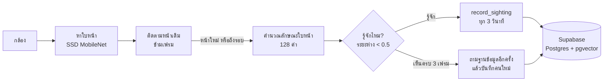

<div align="center">

# 👀 Seen Again

**รู้ว่าใครกลับมา มาตอนไหน และมาแล้วกี่ครั้ง จากกล้องตัวไหนก็ได้ ทำงานในเบราว์เซอร์ทั้งหมด**

[English](README.md) · [ภาษาไทย](README.th.md)


</div>

---

Seen Again ดูภาพจากกล้อง จดจำใบหน้า และเก็บประวัติการมาของทุกคนที่เจอ ได้แก่ มาครั้งแรกเมื่อไหร่
กลับมากี่ครั้ง แต่ละครั้งอยู่นานแค่ไหน และห่างจากครั้งก่อนเท่าไหร่

การตรวจจับและจดจำใบหน้าทำ**ในเบราว์เซอร์ทั้งหมด** (ใช้ GPU ผ่าน WebGL) วิดีโอไม่ถูกส่งออกจากเครื่อง
สิ่งที่บันทึกมีแค่ลักษณะใบหน้า (ตัวเลข 128 ค่า) รูปหน้าขนาดเล็ก และเวลา

## ✨ ความสามารถ

- **จำหน้าได้เร็ว** ทำงานประมาณ 15 เฟรมต่อวินาทีบน GPU เห็นกรอบหน้าภายใน ~0.2 วินาที และบันทึกคนใหม่ภายใน ~0.5 วินาที
- **นับจำนวนครั้งที่มา** ถ้าคนนั้นหายไปนานกว่าที่ตั้งไว้ (ค่าเริ่มต้น 5 นาที) แล้วกลับมา จะนับเป็นครั้งใหม่
- **สรุปรายบุคคล** จำนวนครั้งที่มา เจอครั้งแรกและล่าสุด ระยะห่างเฉลี่ย เวลารวมหน้ากล้อง ช่วงเวลาและวันที่มาบ่อย
- **ประวัติการเข้า** ทุกครั้งที่มามีลำดับครั้ง รูปหน้า และชื่อกล้องที่เห็น
- **ใช้หลายกล้องได้** ทุกเครื่องใช้ฐานข้อมูลใบหน้าเดียวกัน และกันการบันทึกคนเดียวกันซ้ำจากคนละกล้อง
- **บันทึกการแจกของ** สำหรับโรงทานหรือจุดแจกของ กดปุ่มเดียวก็บันทึกว่าคนที่อยู่หน้ากล้องได้อะไรไป และเตือนเมื่อคนเดิมกลับมารับซ้ำในวันเดียวกัน
- **จัดการข้อมูลได้** ตั้งชื่อ รวมคนที่ระบบแยกเป็นสองคน ลบรายบุคคลหรือลบทั้งหมด
- **ปลอดภัยตั้งแต่ต้น** แต่ละบัญชีเห็นเฉพาะข้อมูลของตัวเอง (Row Level Security) และรูปเก็บแบบ private เปิดได้ผ่านลิงก์ที่หมดอายุเอง
- **หน้าขอสิทธิ์ใช้กล้อง** มีวิธีแก้ไขให้ทุกเบราว์เซอร์และระบบปฏิบัติการเมื่อสิทธิ์ถูกบล็อก

## 🧠 หลักการทำงาน



1. ทุกเฟรม เบราว์เซอร์หาใบหน้าและติดตามแต่ละหน้าข้ามเฟรม จึงคำนวณลักษณะใบหน้า (ส่วนที่ใช้เวลามาก)
   เฉพาะหน้าใหม่ ส่วนหน้าที่รู้จักแล้วจะคำนวณซ้ำแค่วินาทีละครั้ง
2. เทียบลักษณะใบหน้ากับคนที่รู้จักด้วยระยะห่าง ถ้าน้อยกว่า 0.5 ถือว่าเป็นคนเดียวกัน
3. หน้าที่ไม่รู้จักและเห็นครบ 3 เฟรม จะถูกเทียบกับฐานข้อมูลอีกครั้ง เผื่อกล้องอื่นเพิ่งบันทึกคนนี้ไป
   ถ้าไม่พบจึงบันทึกเป็นคนใหม่
4. ระหว่างที่คนยังอยู่หน้ากล้อง ระบบเรียก `record_sighting` ทุก 3 วินาที ฟังก์ชันนี้ทำงาน**ในฐานข้อมูลและใช้เวลาของเซิร์ฟเวอร์**
   ถ้าคนนั้นหายไปนานกว่าที่ตั้งไว้ จะเริ่มนับเป็นครั้งใหม่

## 🚀 เริ่มต้นใช้งาน

เลือกแบบใดแบบหนึ่ง

| | รันที่ไหน | ค่าใช้จ่าย | เหมาะกับ |
|---|---|---|---|
| **A. Server ที่บ้าน** | PC ของคุณ + [Tailscale](https://tailscale.com) | ฟรี | อยากเก็บข้อมูลไว้ที่บ้าน แต่เข้าใช้จากที่ไหนก็ได้ |
| **B. Cloud** | [Supabase](https://supabase.com) + [Netlify](https://netlify.com) | ฟรี (แพ็กเกจฟรี) | ไม่อยากเปิดเครื่องทิ้งไว้ |

**ต้องมี:** Node.js 22 ขึ้นไป ถ้าใช้แบบ A ต้องมี [Docker Desktop](https://www.docker.com/products/docker-desktop/) ด้วย (บน Windows ต้องเปิด WSL 2)

### A. Server ที่บ้าน (PC) แล้วเข้าใช้จากที่ไหนก็ได้

ทุกอย่าง ทั้งเว็บ ฐานข้อมูล และรูป อยู่บน PC เครื่องเดียว Tailscale เชื่อม PC กับโน้ตบุ๊กได้แม้อยู่คนละเครือข่าย
และให้ HTTPS ซึ่งจำเป็นสำหรับการใช้กล้อง เข้าได้เฉพาะอุปกรณ์ที่ล็อกอิน Tailscale บัญชีเดียวกับคุณเท่านั้น

```
โน้ตบุ๊ก (กล้อง + เบราว์เซอร์) ──HTTPS ผ่าน Tailscale──▶ PC: เว็บ :3000 ──▶ Supabase ในเครื่อง :54321
```

เบราว์เซอร์คุยกับ Supabase ผ่านเว็บที่ path `/supabase` จึงเปิดออกไปข้างนอกแค่พอร์ตเดียว

**ติดตั้งบน PC (ครั้งเดียว)**

```bash
git clone https://github.com/madara1150/seen-again.git
cd seen-again
npm install
npx supabase start        # ครั้งแรกจะโหลดนาน และสร้างตารางจาก supabase/migrations ให้อัตโนมัติ
```

สร้างไฟล์ `.env.local` โดยใช้ **Publishable key** ที่ `supabase start` แสดง

```env
NEXT_PUBLIC_SUPABASE_URL=/supabase
SUPABASE_INTERNAL_URL=http://127.0.0.1:54321
NEXT_PUBLIC_SUPABASE_PUBLISHABLE_KEY=sb_publishable_...
```

จากนั้น

1. ติดตั้ง Tailscale บน**ทั้ง** PC และโน้ตบุ๊ก แล้วล็อกอินบัญชีเดียวกัน
2. ที่ [Tailscale admin → DNS](https://login.tailscale.com/admin/dns) เปิด **MagicDNS** และ **HTTPS Certificates**
3. บน PC รัน `tailscale serve --bg 3000` จะได้ URL เช่น `https://my-pc.tailxxxx.ts.net` ตั้งครั้งเดียว รีสตาร์ตเครื่องแล้วยังอยู่
4. ตั้ง PC ไม่ให้เข้าโหมด sleep

**ทุกครั้งที่เปิดเครื่อง** (เปิด Docker Desktop ก่อน)

```bash
npx supabase start
npm run serve             # build และรันแบบ production ที่พอร์ต 3000
```

เปิด URL ของ Tailscale บนโน้ตบุ๊กแล้วสมัครบัญชีของคุณ จากนั้นปิดการสมัครสมาชิกใหม่ โดยแก้
`supabase/config.toml` ในส่วน `[auth]` เป็น `enable_signup = false` แล้วรัน `npx supabase stop` ตามด้วย `npx supabase start`

> [!WARNING]
> ห้ามเปิดพอร์ต 54321–54324 ออกอินเทอร์เน็ตเด็ดขาด Supabase Studio (54323) ไม่มีรหัสผ่าน
> `npx supabase stop` ข้อมูลยังอยู่ แต่ `npx supabase db reset` และ `stop --no-backup` จะลบข้อมูลทั้งหมด
> สำรองข้อมูลด้วย `npx supabase db dump --data-only -f backup.sql` (ไม่รวมรูปใน Storage)

### B. Cloud (Supabase + Netlify)

1. **Supabase** สร้างโปรเจกต์ที่ [supabase.com](https://supabase.com) เลือก region ที่ใกล้ เช่น Singapore
   - เปิด **SQL Editor** วางเนื้อหาไฟล์ [`supabase/migrations/20261103000000_init.sql`](supabase/migrations/20261103000000_init.sql) แล้วกด **Run**
     (หรือใช้ `npx supabase link --project-ref <ref>` ตามด้วย `npx supabase db push`)
   - **Authentication → URL Configuration:** ตั้ง **Site URL** เป็น URL ของ Netlify และเพิ่ม
     `https://<your-site>.netlify.app/auth/callback` กับ `http://localhost:3000/auth/callback` ใน **Redirect URLs**
   - copy **Project URL** และ **Publishable key** จาก **Project Settings → API Keys**
2. **Netlify** กด **Add new site → Import an existing project** แล้วเลือก repo นี้
   ค่า build อ่านจาก `netlify.toml` ให้เอง เพิ่ม environment variables
   `NEXT_PUBLIC_SUPABASE_URL` และ `NEXT_PUBLIC_SUPABASE_PUBLISHABLE_KEY` แล้วกด deploy
3. หลังสมัครบัญชีของตัวเองแล้ว ให้ปิด **Authentication → Sign In / Providers → Allow new users to sign up**

ข้อจำกัดแพ็กเกจฟรี: Supabase Free มีฐานข้อมูลประมาณ 500MB และ Storage ประมาณ 1GB (รูปหน้ารูปละ ~10KB)
และจะพักโปรเจกต์ถ้าไม่มีการใช้งานประมาณ 7 วัน ไฟล์โมเดลใบหน้า (~12MB) เบราว์เซอร์จะ cache ไว้หลังโหลดครั้งแรก

### พัฒนาในเครื่อง

```bash
cp .env.example .env.local   # ใส่ค่าให้ครบ
npm install
npx supabase start           # ถ้าต้องการ Supabase ในเครื่อง (ใช้ Docker)
npm run dev                  # http://localhost:3000
```

| คำสั่ง | ทำอะไร |
|---|---|
| `npm run dev` | รันแบบพัฒนา |
| `npm run serve` | build แล้วรันแบบ production |
| `npm run typecheck` | ตรวจ TypeScript |
| `npm run lint` | ตรวจด้วย ESLint |

## ⚙️ การตั้งค่า

ตั้งแยกแต่ละเครื่องได้ที่หน้า **ตั้งค่า**

| ค่า | ค่าเริ่มต้น | ความหมาย |
|---|---|---|
| ความเข้มงวดในการจับคู่ | `0.5` | ยิ่งน้อยยิ่งเข้มงวด ถ้าคนเดียวถูกแยกเป็นหลายคนบ่อย ให้เพิ่มค่านี้ |
| ระยะห่างที่นับเป็นครั้งใหม่ | `5 นาที` | หายไปนานเท่านี้แล้วกลับมา จะนับเป็นการมาครั้งใหม่ |
| ขนาดหน้าขั้นต่ำ | `80 px` | ไม่สนใจหน้าที่เล็กกว่านี้ เพราะไกลเกินจะจำได้แม่น |
| ชื่อกล้อง | — | แสดงในประวัติ เช่น "ประตูหน้า" |

**ใช้หลายกล้อง:** เปิดเว็บบนแต่ละเครื่อง ล็อกอินบัญชีเดียวกัน แล้วตั้งชื่อกล้องให้แต่ละเครื่อง ทุกเครื่องจะใช้ฐานข้อมูลใบหน้าเดียวกัน

## 🍱 บันทึกการแจกของ (โรงทาน, จุดแจกของ)

รู้ว่าแจกไปเท่าไหร่ ใครรับอะไรไปบ้าง และรับตอนไหน

1. ที่หน้า **การแจก** ส่วน **รายการของที่แจก** ให้เพิ่มสิ่งที่จะแจกพร้อมหน่วย เช่น *ข้าวกล่อง / กล่อง*, *น้ำดื่ม / ขวด*
2. ที่หน้ากล้อง กล่อง **แจกของ** จะเลือกคนที่หน้าใหญ่ที่สุดในภาพ ซึ่งมักเป็นคนที่ยืนใกล้ที่สุด ให้อัตโนมัติ (มีกรอบสีน้ำเงินบนวิดีโอ)
   ถ้ามีหลายคนในภาพ แตะชื่อเพื่อเลือกคนอื่นได้
3. แตะปุ่มรายการเพื่อบันทึก **+1** ให้คนนั้น ถ้ากดผิดให้แตะ **ยกเลิก** เพื่อลบรายการล่าสุด
4. กล่องจะแสดงว่าคนนี้รับอะไรไปแล้วบ้างในวันนี้ การกดที่ห่างกันไม่เกิน 5 นาทีนับเป็นรอบเดียวกัน
   ถ้าขึ้นป้ายสีแดง แปลว่าคนนี้กลับมารับอีกรอบ
5. หน้า **การแจก** เลือกดูได้ทีละวัน มียอดรวมแต่ละรายการ จำนวนที่แจกในแต่ละชั่วโมง แต่ละคนรับอะไรไปกี่รอบ
   รายการทั้งหมดซึ่งลบได้ และปุ่ม **ดาวน์โหลด CSV** สำหรับเปิดใน Excel

รายการที่เคยแจกไปแล้วลบไม่ได้ ให้ใช้ **ซ่อน** แทน ประวัติการแจกจะยังอยู่ครบ

## 🗂️ โครงสร้างโปรเจกต์

```
src/
  proxy.ts                  ตรวจ session และส่งคนที่ยังไม่ล็อกอินไปหน้า /login
  app/                      หน้า: กล้อง (/), /people, /people/[id], /history, /settings, /login
  components/CameraView     กล้อง loop ตรวจจับ และหน้าขอสิทธิ์กล้อง
  components/HandoutPanel   ปุ่มแจกของข้างกล้อง
  app/handouts/             สรุปการแจกรายวัน ดาวน์โหลด CSV และรายการของ
  lib/tracker.ts            ติดตามหน้า จับคู่ บันทึกคนใหม่ และรายงานการมา
  lib/supabase/             client ฝั่งเบราว์เซอร์/เซิร์ฟเวอร์ และค่าสำหรับ /supabase
supabase/migrations/        schema, RLS, ฟังก์ชัน SQL, storage bucket
scripts/copy-models.mjs     copy โมเดล face-api ไปที่ public/models ตอน npm install
```

**ฐานข้อมูล:** ตาราง `people`, `face_descriptors` (`vector(128)` พร้อม HNSW index), `visits`, `items`, `handouts`
view `people_stats` กับ `visits_numbered` และฟังก์ชัน `match_face`, `record_sighting`, `merge_people`

## 🔒 ความเป็นส่วนตัว (PDPA)

ข้อมูลใบหน้าที่ใช้ระบุตัวบุคคลเป็น**ข้อมูลส่วนบุคคลที่อ่อนไหว** ตาม PDPA มาตรา 26 ถ้าใช้กล้องกับคนอื่นนอกจากตัวเอง ควร

- ติดป้ายแจ้งว่ามีการบันทึกใบหน้า ระบุวัตถุประสงค์และผู้ควบคุมข้อมูล และขอความยินยอมตามที่กฎหมายกำหนด
- จำกัดผู้เข้าถึง ปิดการสมัครสมาชิกใหม่ และใช้รหัสผ่านที่แข็งแรง
- ลบข้อมูลที่ไม่จำเป็นแล้ว ลบรายบุคคลได้ที่หน้าของคนนั้น หรือลบทั้งหมดที่หน้าตั้งค่า

## 🛠️ สร้างด้วย

[Next.js](https://nextjs.org) ·
[TypeScript](https://www.typescriptlang.org) ·
[@vladmandic/face-api](https://github.com/vladmandic/face-api) ·
[Supabase](https://supabase.com) (Postgres, pgvector, Auth, Storage) ·
[Tailscale](https://tailscale.com) / [Netlify](https://netlify.com)
